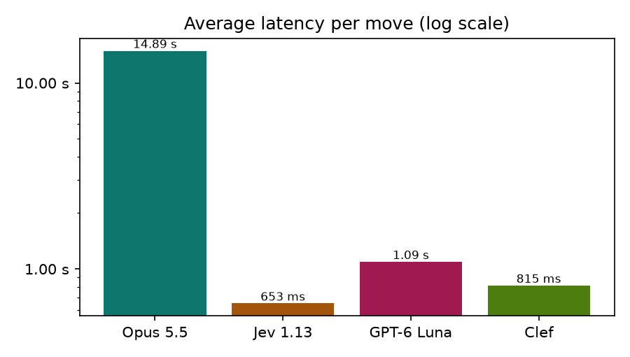
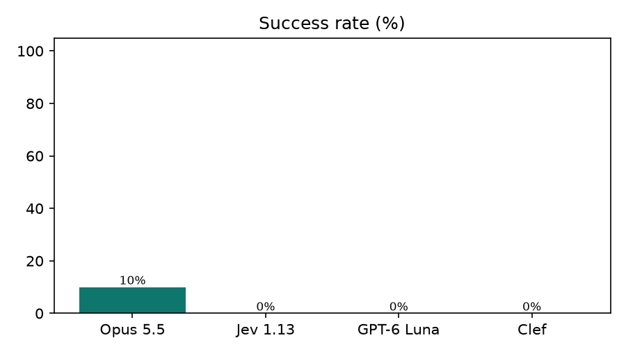
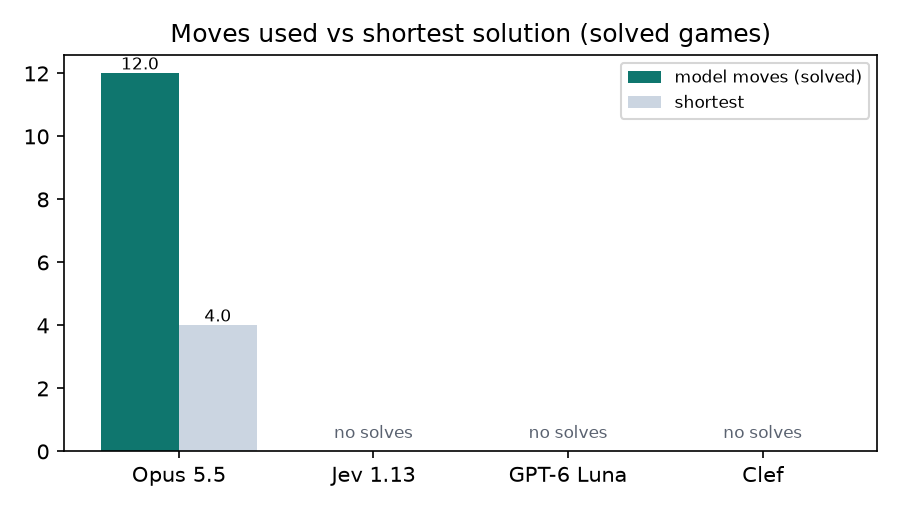
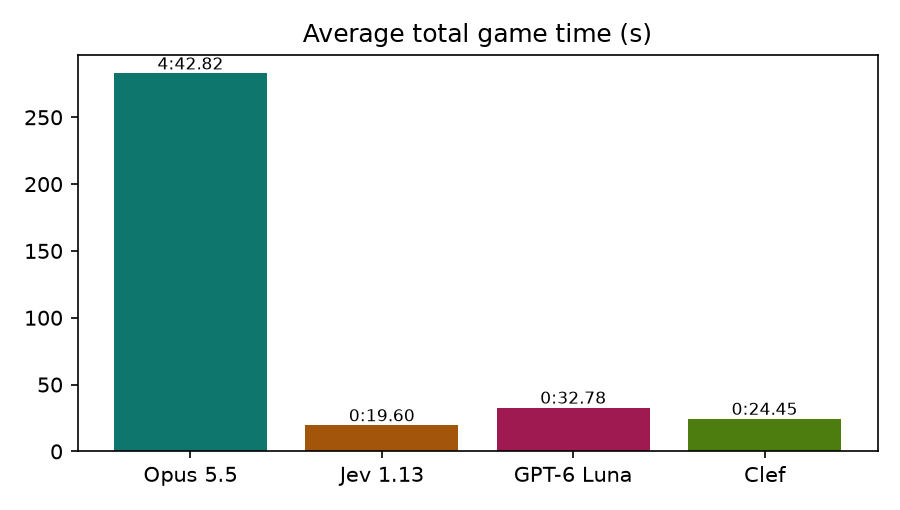

# 🧊 Rubik's Cube Race: Fast Decision Models vs. a Frontier LLM

**AI Engineering · Assignment 02**
**Student:** Yesaullah Sheikh · **Roll No:** `23K-0019`

> Is a model that decides in milliseconds more useful than a frontier LLM that spends longer planning, if the slower model solves the task in fewer moves?

Four OpenRouter models race to solve the **same scrambled 3×3 cube** under identical rules. Each one picks one move at a time until the cube is solved or it hits the limit of **30 moves** (or **5 minutes**). For every model we measure **speed** (latency per move, total game time) and **thinking quality** (solve rate, moves used vs. the exact BFS shortest solution).

---

## 🎬 Demo video

<!-- After recording: drag media/demo.mp4 into this README in GitHub's web editor to get an inline player here. -->

[](media/demo.mp4)

**▶ Direct link: [media/demo.mp4](media/demo.mp4)**

The recording shows (1) the models mid-race, (2) the finished race with ranks and statuses, and (3) the final benchmark results slide. The student name and roll number stay on screen for the whole recording.

---

## 🏁 Key findings

Live run, 2026-10-20: 14 puzzles × 4 models = **56 trials** (2 warm-up, 10 primary, 2 extension). Every logged move was replayed on the cube engine to re-check each solved/unsolved result: 0 mismatches. Total OpenRouter cost: **$3.66**.

| Question | Answer | Evidence (primary set unless noted) |
|---|---|---|
| 1. Which model is fastest at making decisions? | **Jev 1.13** | 653 ms mean per move (median 620 ms, p95 845 ms). Clef: 815 ms, GPT-6 Luna: 1.09 s, Opus 5.5: 14.89 s, about 23× slower than Jev. |
| 2. Which model achieved the highest solve rate? | **Opus 5.5** | 1/10 primary (10%) and 1/2 warm-up: 2 of 12 small cubes. All three decision models solved **0 of 14** cubes across every set. No model solved an extension cube. |
| 3. Which model found the shortest solutions, and how close to the optimum? | **Opus 5.5**, the only model that solved anything, but never optimally | `primary-09`: 12 moves vs. 4 shortest (gap **+8**). `warmup-01`: 5 vs. 3 (gap **+2**). Mean gap over its 2 solves: **+5**; 0 optimal solves. |
| 4. Did the fastest model also achieve the best solution quality? | **No** | Jev was fastest but solved 0/14. On every puzzle it alternated `U U' U U' …` until the 30-move limit, so its speed only made it reach the limit sooner (about 20 s per game). |
| 5. Fastest decision model, frontier LLM, or hybrid for a real application? | **A hybrid**, with a verifier or search component doing the state tracking | See below. |

**Why a hybrid (Q5).** Neither model type is usable alone on this task:

- **The decision models are fast but not reliable.**
  - Jev and Clef answered in under a second, but they fell into move/undo loops and never solved a cube. Jev used only `U` and `U'` in all 14 games. Their reported confidence was low (Clef about 8% on average, close to the uniform 1/18 ≈ 6%), so they were effectively guessing.
  - GPT-6 Luna only ever played U and R turns. In 9 of its 14 games it reached a position it refused to answer (HTTP 502 "refused to answer"), then forfeited every remaining turn: **237 refusals** in total, and 0 moves at all on `primary-06`. A model that can decline mid-task needs a fallback.
- **The frontier LLM is better but slow and expensive.**
  - Opus solved 2 of 12 small cubes, both well above the optimum.
  - At about 15 s per move, 7 of 10 primary games hit the 5-minute limit.
  - Its 10 primary games cost **$2.98**, against about **$0.01** for each decision model.
  - It also fell into undo pairs (`R R' U U'`): reasoning about a raw 54-character state is hard even for a strong LLM.

**What would work.** A practical agent would let the fast model propose moves, and use a cheap deterministic check (the cube engine itself: reject immediate undos, detect loops, measure progress) to accept or veto them. It would escalate to the LLM, or better a real solver, only when progress stalls. For the exact-optimum part the evidence is clearest: the BFS used to build this benchmark finds the shortest solution of every primary puzzle in milliseconds, which no model came close to.

**Other observations**
- Total game time is not a quality measure. The decision models finished fastest (about 20–33 s per game) *because* they used up their 30 moves quickly without solving.
- Opus reasoned less on hard positions: 6.1 s per move on the extension set against 14.9 s on primary. It hit the move limit there, not the time limit.

---|---|---|
| 1. Which model is fastest at making decisions? | – | – |
| 2. Which model achieved the highest solve rate? | – | – |
| 3. Which model found the shortest solutions, and how close to the optimum? | – | – |
| 4. Did the fastest model also achieve the best solution quality? | – | – |
| 5. Fastest decision model, frontier LLM, or hybrid for a real application? | – | – |

---

## 📊 Results

<!-- RESULTS:START -->
_Generated from `results/trials.jsonl` (56 model-puzzle trials)._

### Primary benchmark (4–5 turn scrambles, exact BFS optimum)

| Model | Type | Trials | Success rate | Avg latency / move | Median | p95 | Avg total time | Avg moves | Avg moves (solved) vs shortest | Mean optimality gap | Gap = 0 | Forfeited turns | Refusals | Malformed outputs | Retries | Cost |
|---|---|---|---|---|---|---|---|---|---|---|---|---|---|---|---|---|
| **Opus 5.5** (`anthropic/claude-opus-5.5`) | Frontier LLM | 10 | **10%** (1/10) | **14.89 s** | 12.56 s | 32.38 s | 4:42.82 | 18.4 | 12.0 vs 4.0 | **+8.00** | 0 | 0 | 0 | 0 | 0 | $2.978 |
| **Jev 1.13** (`typesafe/jev-1.13`) | Decision | 10 | **0%** (0/10) | **653 ms** | 620 ms | 845 ms | 0:19.60 | 30.0 | – vs – | **–** | 0 | 0 | 0 | 0 | 0 | $0.010 |
| **GPT-6 Luna** (`openai/gpt-6-luna-decisions`) | Decision | 10 | **0%** (0/10) | **1.09 s** | 1.38 s | 1.72 s | 0:32.78 | 14.1 | – vs – | **–** | 0 | 159 | 159 | 0 | 318 | $0.006 |
| **Clef** (`cloudflare/clef`) | Decision | 10 | **0%** (0/10) | **815 ms** | 721 ms | 1.36 s | 0:24.45 | 30.0 | – vs – | **–** | 0 | 0 | 0 | 0 | 0 | $0.010 |


   


<details><summary>Per-puzzle results (primary)</summary>

| Puzzle | Shortest | Opus 5.5 | Jev 1.13 | GPT-6 Luna | Clef |
|---|---|---|---|---|---|
| `primary-01` | 4 | ❌ time limit · 5:00.02 | ❌ move limit · 0:19.00 | ❌ move limit · 0:42.41 | ❌ move limit · 0:24.23 |
| `primary-02` | 5 | ❌ move limit · 3:36.42 | ❌ move limit · 0:18.22 | ❌ move limit · 0:45.34 | ❌ move limit · 0:22.92 |
| `primary-03` | 4 | ❌ time limit · 5:00.03 | ❌ move limit · 0:17.89 | ❌ move limit · 0:40.48 | ❌ move limit · 0:21.68 |
| `primary-04` | 5 | ❌ time limit · 5:00.01 | ❌ move limit · 0:19.83 | ❌ move limit · 0:16.24 | ❌ move limit · 0:25.45 |
| `primary-05` | 4 | ❌ time limit · 5:00.02 | ❌ move limit · 0:19.33 | ❌ move limit · 0:15.87 | ❌ move limit · 0:24.05 |
| `primary-06` | 5 | ❌ time limit · 5:00.01 | ❌ move limit · 0:20.14 | ❌ move limit · 0:47.95 | ❌ move limit · 0:25.33 |
| `primary-07` | 4 | ❌ time limit · 5:00.01 | ❌ move limit · 0:19.68 | ❌ move limit · 0:45.15 | ❌ move limit · 0:24.11 |
| `primary-08` | 5 | ❌ time limit · 5:00.02 | ❌ move limit · 0:22.60 | ❌ move limit · 0:18.11 | ❌ move limit · 0:27.41 |
| `primary-09` | 4 | ✅ 12 (+8) · 3:52.51 | ❌ move limit · 0:20.12 | ❌ move limit · 0:40.09 | ❌ move limit · 0:22.64 |
| `primary-10` | 5 | ❌ move limit · 4:39.13 | ❌ move limit · 0:19.16 | ❌ move limit · 0:16.17 | ❌ move limit · 0:26.65 |

</details>

### Warm-up (3–4 turn scrambles)

| Model | Type | Trials | Success rate | Avg latency / move | Median | p95 | Avg total time | Avg moves | Avg moves (solved) vs shortest | Mean optimality gap | Gap = 0 | Forfeited turns | Refusals | Malformed outputs | Retries | Cost |
|---|---|---|---|---|---|---|---|---|---|---|---|---|---|---|---|---|
| **Opus 5.5** (`anthropic/claude-opus-5.5`) | Frontier LLM | 2 | **50%** (1/2) | **19.96 s** | 21.61 s | 31.63 s | 3:10.60 | 9.5 | 5.0 vs 3.0 | **+2.00** | 0 | 0 | 0 | 0 | 0 | $0.443 |
| **Jev 1.13** (`typesafe/jev-1.13`) | Decision | 2 | **0%** (0/2) | **627 ms** | 593 ms | 771 ms | 0:18.81 | 30.0 | – vs – | **–** | 0 | 0 | 0 | 0 | 0 | $0.002 |
| **GPT-6 Luna** (`openai/gpt-6-luna-decisions`) | Decision | 2 | **0%** (0/2) | **1.33 s** | 1.40 s | 1.70 s | 0:39.79 | 5.5 | – vs – | **–** | 0 | 49 | 49 | 0 | 98 | $0.000 |
| **Clef** (`cloudflare/clef`) | Decision | 2 | **0%** (0/2) | **788 ms** | 658 ms | 1.69 s | 0:23.63 | 30.0 | – vs – | **–** | 0 | 0 | 0 | 0 | 0 | $0.002 |


<details><summary>Per-puzzle results (warmup)</summary>

| Puzzle | Shortest | Opus 5.5 | Jev 1.13 | GPT-6 Luna | Clef |
|---|---|---|---|---|---|
| `warmup-01` | 3 | ✅ 5 (+2) · 1:21.20 | ❌ move limit · 0:18.90 | ❌ move limit · 0:42.94 | ❌ move limit · 0:21.70 |
| `warmup-02` | 4 | ❌ time limit · 5:00.01 | ❌ move limit · 0:18.71 | ❌ move limit · 0:36.64 | ❌ move limit · 0:25.56 |

</details>

### Extension (15–20 turn scrambles, best-known reference)

| Model | Type | Trials | Success rate | Avg latency / move | Median | p95 | Avg total time | Avg moves | Avg moves (solved) vs shortest | Mean optimality gap | Gap = 0 | Forfeited turns | Refusals | Malformed outputs | Retries | Cost |
|---|---|---|---|---|---|---|---|---|---|---|---|---|---|---|---|---|
| **Opus 5.5** (`anthropic/claude-opus-5.5`) | Frontier LLM | 2 | **0%** (0/2) | **6.14 s** | 5.96 s | 9.54 s | 3:04.18 | 30.0 | – vs – | **–** | 0 | 0 | 0 | 0 | 0 | $0.207 |
| **Jev 1.13** (`typesafe/jev-1.13`) | Decision | 2 | **0%** (0/2) | **709 ms** | 687 ms | 827 ms | 0:21.29 | 30.0 | – vs – | **–** | 0 | 0 | 0 | 0 | 0 | $0.002 |
| **GPT-6 Luna** (`openai/gpt-6-luna-decisions`) | Decision | 2 | **0%** (0/2) | **1.07 s** | 1.16 s | 1.85 s | 0:32.02 | 15.5 | – vs – | **–** | 0 | 29 | 29 | 0 | 58 | $0.001 |
| **Clef** (`cloudflare/clef`) | Decision | 2 | **0%** (0/2) | **913 ms** | 773 ms | 2.08 s | 0:27.40 | 30.0 | – vs – | **–** | 0 | 0 | 0 | 0 | 0 | $0.002 |


<details><summary>Per-puzzle results (extension)</summary>

| Puzzle | Shortest | Opus 5.5 | Jev 1.13 | GPT-6 Luna | Clef |
|---|---|---|---|---|---|
| `extension-01` | 15* | ❌ move limit · 2:59.97 | ❌ move limit · 0:21.73 | ❌ move limit · 0:47.82 | ❌ move limit · 0:28.95 |
| `extension-02` | 20* | ❌ move limit · 3:08.39 | ❌ move limit · 0:20.84 | ❌ move limit · 0:16.22 | ❌ move limit · 0:25.85 |

</details>

<!-- RESULTS:END -->

---

## 🧪 Experiment design

| Item | Setting |
|---|---|
| Models | Jev 1.13 `typesafe/jev-1.13`, GPT-6 Luna Decisions `openai/gpt-6-luna-decisions`, Clef `cloudflare/clef` (Decisions API); Claude Opus 5.5 `anthropic/claude-opus-5.5` (chat completions) |
| Move metric | Half-turn metric (HTM): 18 actions `U U' U2 R R' R2 F F' F2 D D' D2 L L' L2 B B' B2` |
| Test sets | Warm-up: 2 puzzles (3–4 turns) · **Primary: 10 puzzles (4–5 turns)** · Extension: 2 puzzles (15 and 20 turns) |
| Trials | Every model plays every puzzle from the identical start state: 14 puzzles × 4 models = 56 trials (40 primary) |
| Scrambles | Seeded (`SUITE_SEED = 20261020`), with no same-face repeats and no `X Y X` opposite-face patterns. Committed in [`data/puzzles.json`](data/puzzles.json) |
| Shortest solution | **Bidirectional BFS** (complete and exact) for warm-up and primary. Extension: best-known upper bound (inverse scramble), not proven optimal |
| Move limit | 30 moves per game; reaching it counts as *not solved* |
| Time limit | 5 minutes of wall-clock time per game; reaching it counts as *not solved* |
| Per-move timeout / retries | 120 s per request; up to 2 retries on timeouts, 429/5xx errors or malformed output. **Same policy for every model** |
| Invalid output | Logged and counted, **never** coerced into a move. If a turn is still invalid after retries, it is forfeited: it counts toward the 30-move limit and the cube is unchanged |
| History policy | Every model sees the last 5 moves (`recent_moves`) |
| Opus settings | `reasoning.effort = "medium"` and `max_tokens = 8000`. Structured output: JSON schema with an enum of the 18 moves. See *Why medium effort* below |
| Execution | The four models run **concurrently** for each puzzle (asyncio), so run order gives no model an advantage |
| Ranking (per race) | Solved games first (fewest moves, then fastest); then unsolved games by stickers already in place |

#### Why medium effort

A first warm-up at `reasoning.effort = "low"` showed Opus thinking about its first move or two and then answering with almost no reasoning (107 reasoning tokens in one whole 30-move game). It then played undo pairs such as `L' L R R'`. That does not test "a frontier LLM that spends longer planning", so the setting was raised for all sets and the warm-up was re-run. Pre-run test on `warmup-02` (shortest solution 4), 10 moves each, not part of the results:

| Effort | Time per move | Cost per move | After 10 moves |
|---|---|---|---|
| low | 3–8 s | about $0.003 | undo pairs, not solved |
| medium | about 17 s | about $0.02 | not solved |
| high | about 35 s (up to 93 s) | about $0.046 | not solved; opening `F R' F U2` against optimal `F2 R' D' U2` |

The low-effort warm-up trials are kept in `results/archive/warmup-low-effort/` for transparency and are not part of the reported results.

### Metrics

- **Latency per move**: wall time of one decision request (retries included), measured with `time.perf_counter()` around the HTTP call. Reported as mean, median and p95.
- **Total time**: wall-clock time from game start until the cube is solved or a limit is hit.
- **Total moves**: moves applied to the cube.
- **Success rate**: solved games ÷ games played.
- **Optimality gap** = model moves − exact shortest moves, averaged over **solved** games. Unsolved games are reported separately and never counted as a gap.

### State / action contract (identical for all models)

The game is turned into a state/action space, as with the Snake example from class. Each turn the model receives:

```json
{
  "cube_facelets": "UUUUUUUUURRRRRRRRRFFFFFFFFFDDDDDDDDDLLLLLLLLLBBBBBBBBB",
  "recent_moves": ["R", "U'", "F2"]
}
```

`cube_facelets` uses the standard 54-sticker URFDLB order; `recent_moves` holds the last 5 moves (the same window for every model). This is exactly the request shape in the assignment's Decisions API example.

- **Decision models** (`POST https://openrouter.ai/api/alpha/decisions`) get this as `state`, plus one typed `choice` question `next_move` with the brief's instruction, *"Choose the single next move most likely to progress toward the solved cube."*, and 18 `criteria`, one per legal move (for example `"U": "Turn the upper face clockwise by 90 degrees"`). The question is identical for all three models; only `model` changes. We record the returned `confidence` and `probabilities` for every move.
- **Opus** (`POST https://openrouter.ai/api/v1/chat/completions`) gets the same instruction and the same 18 move definitions in its system prompt, and the same state JSON as the user message. It must reply with `{"move": "<one of 18>"}`, enforced by `response_format: json_schema`. Replies are validated strictly; code fences, extra keys or illegal moves count as malformed.
- **Forfeits.** If a model gives no valid move after the retries, the turn is forfeited: the cube is unchanged and the turn still counts toward the 30-move limit. Each forfeit is logged with its reason: *refused* (the provider answered HTTP 502 "refused to answer"), *malformed*, *timeout* or *API error*.

#### Why the request is kept this minimal

Pre-run probes (one request per state, about $0.0001 each) showed that `openai/gpt-6-luna-decisions` often refuses with HTTP 502 *"OpenAI refused to answer question next_move"*:

| Request variant (24 sampled mid-game states) | Answered first try |
|---|---|
| Assignment format: `cube_facelets` + `recent_moves`, brief's instruction, move descriptions | 21 / 24 |
| Same, plus a facelet legend in the instruction | 15 / 24 |
| Same, plus a `moves_remaining` counter | 16 / 24 |
| Earlier draft: extra `faces` grid, `legend`, move counters in the state | about 2 / 8 |

So every model gets the assignment's exact format, and nothing is added for one model only. A refusal is deterministic for a given request. When Luna refuses a position, retrying or forfeiting resends the identical request, so the refusal tends to repeat until the game ends. This is reported as Luna's own behaviour (the *Refusals* column), not hidden or worked around.

---

## 🏗️ Architecture

```
frontend (React + Vite + three.js)          backend (FastAPI)                         OpenRouter
┌──────────────────────────────┐   REST   ┌─────────────────────────────────┐   HTTPS   ┌───────────────────────┐
│ Race view (4 live 3D cubes)  │ ───────▶ │ RaceRunner: 4 games in parallel │ ────────▶ │ /api/alpha/decisions   │
│ Benchmark dashboard          │ ◀─ SSE ─ │ cube engine · BFS optimum       │ ◀──────── │ /api/v1/chat/completions│
│ Results slide · Replay       │          │ metrics · JSONL result store    │           └───────────────────────┘
└──────────────────────────────┘          └─────────────────────────────────┘
                                             API key lives only here (.env)
```

| Path | Role |
|---|---|
| [`backend/app/cube/engine.py`](backend/app/cube/engine.py) | Deterministic 54-facelet engine. Move permutations are derived geometrically and checked against the standard (Kociemba) orientation |
| [`backend/app/cube/optimal.py`](backend/app/cube/optimal.py) | Exact shortest solutions via bidirectional BFS |
| [`backend/app/cube/scramble.py`](backend/app/cube/scramble.py) | Seeded scramble generator and the fixed puzzle suite |
| [`backend/app/agents/prompt.py`](backend/app/agents/prompt.py) | The shared state, instructions and move definitions |
| [`backend/app/agents/openrouter.py`](backend/app/agents/openrouter.py) | Decisions API and chat-completions adapters, with strict response parsing |
| [`backend/app/agents/base.py`](backend/app/agents/base.py) | Uniform timeout / retry / invalid-output policy |
| [`backend/app/benchmark/runner.py`](backend/app/benchmark/runner.py) | Game loop, limits, ranking and live event stream |
| [`backend/app/benchmark/metrics.py`](backend/app/benchmark/metrics.py) | Statistics shown on the dashboard and in this README |
| [`results/`](results/) | Raw trial logs (`trials.jsonl`), full move-by-move race logs (`races/`) and `summary.json` |
| [`frontend/src/`](frontend/src/) | Race view, dashboard, results slide and the 3D cube |

---

## ⚙️ Setup and running

**Requirements:** Python 3.11+, Node 18+, and an OpenRouter API key with credits.

```bash
git clone <this-repo> && cd <this-repo>
cp .env.example .env        # then set OPENROUTER_API_KEY and ROLL_NO
```

**Backend**

```bash
cd backend
python -m venv .venv
.venv/Scripts/activate      # Windows; on macOS/Linux use: source .venv/bin/activate
pip install -r requirements.txt
python -m pytest -q         # engine, BFS, adapters, runner
```

**Frontend** (built once, then served by the backend)

```bash
cd frontend
npm install
npm run build
```

**Run the app**, then open http://localhost:8000

```bash
cd backend
python -m uvicorn app.main:app --port 8000
```

For frontend development with hot reload, run `npm run dev` in `frontend/` and open http://localhost:5173. It proxies `/api` to the backend.

**Headless benchmark and report**

```bash
cd backend
python -m app.cli run --set warmup     # check the adapters and the cost
python -m app.cli run --set primary
python -m app.cli run --set extension
python -m app.cli report               # writes results/summary.json, docs/charts/*.png and this README's results
```

The **Mock (dev)** mode uses simulated models so the app can be tested without an API key. Mock results are written to `results/mock/`, which is git-ignored and never reported here.

### Security

The OpenRouter key is read from the backend's `.env` only. The browser never sees it, and `.env` is git-ignored. [`.env.example`](.env.example) is the template.

---

## ⚠️ Limitations

- Opus ran at medium reasoning effort for cost reasons. A pre-run test at high effort was slower (about 35 s per move) and still unsolved after 10 moves, so a higher setting is not expected to change the conclusions, but it was not benchmarked in full.
- One run per puzzle (10 primary puzzles, 40 trials). Model outputs are stochastic, so small differences between models are not statistically conclusive.
- Extension-set references are upper bounds (inverse scramble), so gaps there are relative to a best-known solution, not a proven optimum.
- Latency includes network time to OpenRouter and provider queueing, measured from one client location.
- Model IDs and API schemas were verified on OpenRouter on 2026-10-20. They may change.
