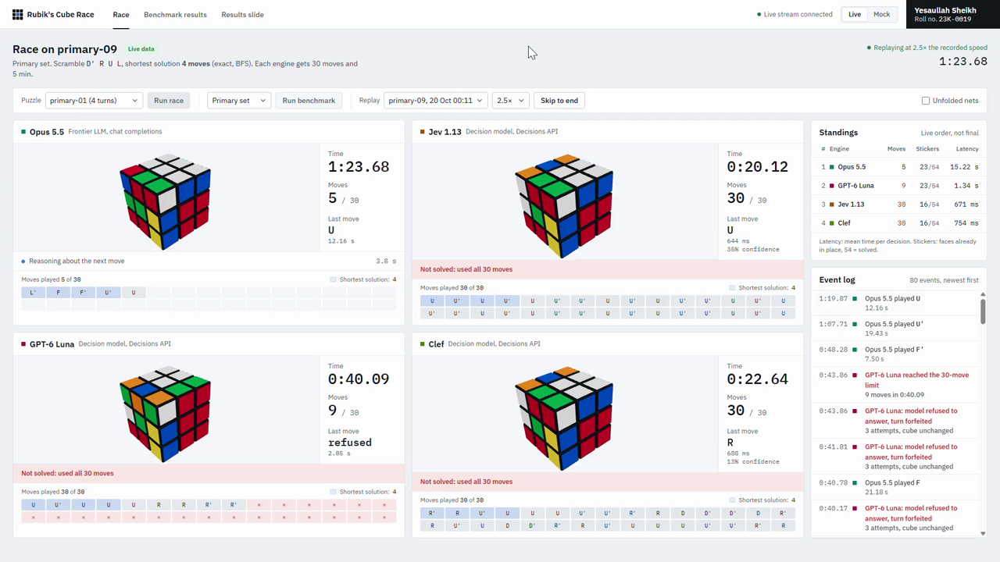

# 🧊 Rubik's Cube Race: Fast Decision Models vs. a Frontier LLM

**AI Engineering · Assignment 02**
**Student:** Yesaullah Sheikh · **Roll No:** `ROLL-NO-HERE`

> Is a model that decides in milliseconds more useful than a frontier LLM that spends longer planning, if the slower model solves the task in fewer moves?

Four OpenRouter models race to solve the **same scrambled 3×3 cube** under identical rules. Each one picks one move at a time until the cube is solved or it hits the limit of **30 moves** (or **5 minutes**). For every model we measure **speed** (latency per move, total game time) and **thinking quality** (solve rate, moves used vs. the exact BFS shortest solution).

---

## 🎬 Demo video

<!-- After recording: drag media/demo.mp4 into this README in GitHub's web editor to get an inline player here. -->

[](media/demo.mp4)

**▶ Direct link: [media/demo.mp4](media/demo.mp4)**

The recording shows (1) the models mid-race, (2) the finished race with ranks and statuses, and (3) the final benchmark results slide. The student name and roll number stay on screen for the whole recording.

---

## 🏁 Key findings

_To be completed from the live benchmark results below._

| Question | Answer | Evidence |
|---|---|---|
| 1. Which model is fastest at making decisions? | – | – |
| 2. Which model achieved the highest solve rate? | – | – |
| 3. Which model found the shortest solutions, and how close to the optimum? | – | – |
| 4. Did the fastest model also achieve the best solution quality? | – | – |
| 5. Fastest decision model, frontier LLM, or hybrid for a real application? | – | – |

---

## 📊 Results

<!-- RESULTS:START -->
_Results are generated by `python -m app.cli report` after the live benchmark._
<!-- RESULTS:END -->

---

## 🧪 Experiment design

| Item | Setting |
|---|---|
| Models | Jev 1.13 `typesafe/jev-1.13`, GPT-6 Luna Decisions `openai/gpt-6-luna-decisions`, Clef `cloudflare/clef` (Decisions API); Claude Opus 5.5 `anthropic/claude-opus-5.5` (chat completions) |
| Move metric | Half-turn metric (HTM): 18 actions `U U' U2 R R' R2 F F' F2 D D' D2 L L' L2 B B' B2` |
| Test sets | Warm-up: 2 puzzles (3–4 turns) · **Primary: 10 puzzles (4–5 turns)** · Extension: 2 puzzles (15 and 20 turns) |
| Trials | Every model plays every puzzle from the identical start state: 14 puzzles × 4 models = 56 trials (40 primary) |
| Scrambles | Seeded (`SUITE_SEED = 20261020`), with no same-face repeats and no `X Y X` opposite-face patterns. Committed in [`data/puzzles.json`](data/puzzles.json) |
| Shortest solution | **Bidirectional BFS** (complete and exact) for warm-up and primary. Extension: best-known upper bound (inverse scramble), not proven optimal |
| Move limit | 30 moves per game; reaching it counts as *not solved* |
| Time limit | 5 minutes of wall-clock time per game; reaching it counts as *not solved* |
| Per-move timeout / retries | 120 s per request; up to 2 retries on timeouts, 429/5xx errors or malformed output. **Same policy for every model** |
| Invalid output | Logged and counted, **never** coerced into a move. If a turn is still invalid after retries, it is forfeited: it counts toward the 30-move limit and the cube is unchanged |
| History policy | Every model sees the last 5 moves (`recent_moves`), plus `moves_used` and `moves_remaining` |
| Opus settings | `reasoning.effort = "low"` and `max_tokens = 4000`, chosen to keep cost manageable. Structured output: JSON schema with an enum of the 18 moves |
| Execution | The four models run **concurrently** for each puzzle (asyncio), so run order gives no model an advantage |
| Ranking (per race) | Solved games first (fewest moves, then fastest); then unsolved games by stickers already in place |

### Metrics

- **Latency per move**: wall time of one decision request (retries included), measured with `time.perf_counter()` around the HTTP call. Reported as mean, median and p95.
- **Total time**: wall-clock time from game start until the cube is solved or a limit is hit.
- **Total moves**: moves applied to the cube.
- **Success rate**: solved games ÷ games played.
- **Optimality gap** = model moves − exact shortest moves, averaged over **solved** games. Unsolved games are reported separately and never counted as a gap.

### State / action contract (identical for all models)

The game is turned into a state/action space, as with the Snake example from class. Each turn the model receives:

```json
{
  "cube_facelets": "UUUUUUUUURRRRRRRRRFFFFFFFFFDDDDDDDDDLLLLLLLLLBBBBBBBBB",
  "faces": {"U": ["UUU","UUU","UUU"], "R": ["RRR","RRR","RRR"], "...": "..."},
  "legend": "54 chars in U,R,F,D,L,B order ... viewing orientation ... notation ...",
  "recent_moves": ["R", "U'", "F2"],
  "moves_used": 3,
  "moves_remaining": 27
}
```

- **Decision models** (`POST https://openrouter.ai/api/alpha/decisions`) get this as `state`, plus one typed `choice` question `next_move`. Its 18 `criteria` describe the legal moves, for example `"U": "Turn the upper face clockwise by 90 degrees"`. The question wording is identical for all three models; only `model` changes. We record the returned `confidence` and `probabilities` for every move.
- **Opus** (`POST https://openrouter.ai/api/v1/chat/completions`) gets the same instruction text and move definitions in its system prompt, and the same state JSON as the user message. It must reply with `{"move": "<one of 18>"}`, enforced by `response_format: json_schema`. Replies are validated strictly; code fences, extra keys or illegal moves count as malformed.

---

## 🏗️ Architecture

```
frontend (React + Vite + three.js)          backend (FastAPI)                         OpenRouter
┌──────────────────────────────┐   REST   ┌─────────────────────────────────┐   HTTPS   ┌───────────────────────┐
│ Race view (4 live 3D cubes)  │ ───────▶ │ RaceRunner: 4 games in parallel │ ────────▶ │ /api/alpha/decisions   │
│ Benchmark dashboard          │ ◀─ SSE ─ │ cube engine · BFS optimum       │ ◀──────── │ /api/v1/chat/completions│
│ Results slide · Replay       │          │ metrics · JSONL result store    │           └───────────────────────┘
└──────────────────────────────┘          └─────────────────────────────────┘
                                             API key lives only here (.env)
```

| Path | Role |
|---|---|
| [`backend/app/cube/engine.py`](backend/app/cube/engine.py) | Deterministic 54-facelet engine. Move permutations are derived geometrically and checked against the standard (Kociemba) orientation |
| [`backend/app/cube/optimal.py`](backend/app/cube/optimal.py) | Exact shortest solutions via bidirectional BFS |
| [`backend/app/cube/scramble.py`](backend/app/cube/scramble.py) | Seeded scramble generator and the fixed puzzle suite |
| [`backend/app/agents/prompt.py`](backend/app/agents/prompt.py) | The shared state, instructions and move definitions |
| [`backend/app/agents/openrouter.py`](backend/app/agents/openrouter.py) | Decisions API and chat-completions adapters, with strict response parsing |
| [`backend/app/agents/base.py`](backend/app/agents/base.py) | Uniform timeout / retry / invalid-output policy |
| [`backend/app/benchmark/runner.py`](backend/app/benchmark/runner.py) | Game loop, limits, ranking and live event stream |
| [`backend/app/benchmark/metrics.py`](backend/app/benchmark/metrics.py) | Statistics shown on the dashboard and in this README |
| [`results/`](results/) | Raw trial logs (`trials.jsonl`), full move-by-move race logs (`races/`) and `summary.json` |
| [`frontend/src/`](frontend/src/) | Race view, dashboard, results slide and the 3D cube |

---

## ⚙️ Setup and running

**Requirements:** Python 3.11+, Node 18+, and an OpenRouter API key with credits.

```bash
git clone <this-repo> && cd <this-repo>
cp .env.example .env        # then set OPENROUTER_API_KEY and ROLL_NO
```

**Backend**

```bash
cd backend
python -m venv .venv
.venv/Scripts/activate      # Windows; on macOS/Linux use: source .venv/bin/activate
pip install -r requirements.txt
python -m pytest -q         # engine, BFS, adapters, runner
```

**Frontend** (built once, then served by the backend)

```bash
cd frontend
npm install
npm run build
```

**Run the app**, then open http://localhost:8000

```bash
cd backend
python -m uvicorn app.main:app --port 8000
```

For frontend development with hot reload, run `npm run dev` in `frontend/` and open http://localhost:5173. It proxies `/api` to the backend.

**Headless benchmark and report**

```bash
cd backend
python -m app.cli run --set warmup     # check the adapters and the cost
python -m app.cli run --set primary
python -m app.cli run --set extension
python -m app.cli report               # writes results/summary.json, docs/charts/*.png and this README's results
```

The **Mock (dev)** mode uses simulated models so the app can be tested without an API key. Mock results are written to `results/mock/`, which is git-ignored and never reported here.

### Security

The OpenRouter key is read from the backend's `.env` only. The browser never sees it, and `.env` is git-ignored. [`.env.example`](.env.example) is the template.

---

## ⚠️ Limitations

- Low reasoning effort was used for Opus to control cost; higher effort might change its quality and latency.
- One run per puzzle (10 primary puzzles, 40 trials). Model outputs are stochastic, so small differences between models are not statistically conclusive.
- Extension-set references are upper bounds (inverse scramble), so gaps there are relative to a best-known solution, not a proven optimum.
- Latency includes network time to OpenRouter and provider queueing, measured from one client location.
- Model IDs and API schemas were verified on OpenRouter on _DATE_. They may change.
